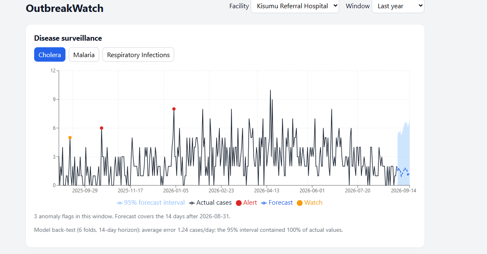

# OutbreakWatch

An early-warning system for hospital disease outbreaks and resource shortfalls. It learns each facility's normal patterns from historical records, forecasts expected caseload with honest uncertainty, flags unusual departures as early outbreak signals, and predicts medicine stock-outs and bed-capacity shortfalls before they happen.

> **Status:** a learning project built on **synthetic data**. It has not been validated on real surveillance data and is **not** a medical or clinical tool. See [Limitations](#limitations).



## What it does

- **Validates incoming data.** Malformed rows are rejected and counted, and gaps and extreme values are flagged. Nothing is silently absorbed.
- **Forecasts caseload** per facility and condition, with 95% prediction intervals and a back-test that reports how often the model is actually wrong.
- **Detects outbreak signals** by comparing actual cases against what the seasonal model expected, using a z-score check for spikes and a CUSUM chart for sustained drift.
- **Predicts shortfalls** for medicines (days until stock-out, with best, expected and worst case) and for bed capacity.
- **Explains itself** with plain-language situation reports. Every number in them is read from a computed value, never generated freehand.

The project began as a concept note for a university hackathon and was built out afterwards as a personal project.

## Quick start

**Backend** (Python 3.12):

```cmd
cd backend
python -m venv venv
venv\Scripts\activate          :: macOS/Linux: source venv/bin/activate
pip install -r requirements.txt

cd data
python generate_sample_data.py
cd ..

uvicorn app.main:app --reload
```

The API is now at http://127.0.0.1:8000, with interactive docs at http://127.0.0.1:8000/docs.

**Frontend** (Node 18+), in a second terminal:

```cmd
cd frontend
npm install
npm run dev
```

Open http://localhost:5173. The first request for each series fits the model and takes a few seconds; later requests are cached.

## Tests

```cmd
cd backend
pytest -m "not slow"     # fast tests, a few seconds
pytest                   # full suite (44 tests, about 20 seconds)
```

The suite replays the known injected events as regression tests: every outbreak must be detected, false alarms must stay low, the stock-out must be predicted with lead time, and ICU beds must use the capacity model.

## How it works

**Ingestion** (`app/ingestion`). Reads CSVs as strings and validates each field explicitly. Rejected rows are counted by reason, and date gaps and extreme single-day values are reported alongside the clean data.

**Forecasting** (`app/forecasting`). An ETS model (additive error, damped additive trend, additive weekly seasonality) projects expected cases with 95% prediction intervals. A rolling-origin back-test reports MAE, RMSE, MAPE and how often the interval actually contained the observed value.

**Anomaly detection** (`app/anomaly_detection`). Anomalies are detected in the *forecast residuals* (actual minus expected), not in raw counts. The first version compared raw counts to a trailing average and flagged over 20% of all days, because it could not tell normal seasonal rise from an outbreak. Working on residuals removes the seasonal signal first, so only what the model did not expect stands out. Two checks run on the residuals: a rolling z-score for sudden spikes, and a one-sided CUSUM for sustained drift. Each has "watch" and "alert" levels.

**Resource tracking** (`app/resource_tracking`). Two kinds of resource need two models:
- *Consumables* (medicines): level is converted to daily consumption (a resupply reads as zero consumed, not negative), consumption is forecast, and the stock is projected forward assuming no further resupply. The question answered is "if nothing changes, when do we run out?"
- *Capacity* (ICU beds): beds free up on discharge, so treating a falling level as consumption would badly overstate depletion. Available capacity is forecast directly instead.

**Summaries** (`app/summaries`). Deterministic templates over already-computed values. There is no language model in the loop, so there is nothing to hallucinate.

## API

| Endpoint | Returns |
|---|---|
| `GET /health` | Row counts and data range |
| `GET /facilities` | Facilities, conditions and resources |
| `GET /data-quality` | Ingestion validation reports |
| `GET /surveillance/{facility}/{condition}?days=` | Case history |
| `GET /forecast/{facility}/{condition}?steps=` | Forecast with 95% interval |
| `GET /backtest/{facility}/{condition}` | MAE, RMSE, MAPE, interval coverage |
| `GET /anomalies/{facility}/{condition}?since_days=` | Watch and alert flags |
| `GET /resources/{facility}/{resource}?days=` | Resource level history |
| `GET /stockout/{facility}/{resource}?horizon=&as_of=` | Days until shortfall (best, expected, worst) |
| `GET /summary/{facility}` | Plain-language situation report |

`as_of` replays a past date, for example `2023-04-18` for the injected ORS stock-out.

## Results (on synthetic data)

The generator injects four known outbreaks and one stock-out into about 4.7 years of daily data for 3 facilities, 3 conditions and 4 resources.

| Check | Result |
|---|---|
| Injected outbreaks detected | 4 of 4 |
| First alert after outbreak start | 1 to 13 days |
| Alert-level false alarms outside outbreak windows | 0 to 0.18% of days |
| 14-day forecast error (Kisumu malaria back-test) | about 3.2 cases/day average |
| 95% interval coverage (same back-test) | about 93% |
| Stock-out warning, replayed as of 2023-04-18 | 13 to 24 days ahead (17 expected) |

These were measured on data the thresholds were tuned against, so they are a best case. They show the pipeline works, not that it will transfer to real data.

## Limitations

- **Synthetic data only.** Real surveillance data is messier: reporting delays, revisions, missing facilities, changing case definitions.
- **Weekly seasonality only.** Annual seasonality is absorbed by the trend and by adaptation rather than modelled, which is documented as a deliberate trade-off in `forecaster.py`.
- **Gaussian-style intervals on counts.** Low-count series (rare diseases) are handled imperfectly, and forecasts are clipped at zero.
- **Increases only.** Detection flags upward deviations; it does not flag unusual drops.
- **Series are independent.** There is no cross-facility or spatial signal.
- **Shortfall projections assume no resupply** by design, and the default safety threshold (10% of the recent maximum level) is a placeholder that should be set per resource.
- **No authentication, no database.** Data loads from CSV at startup and results are cached in memory.

## Ideas for next steps

- Validate on real public surveillance datasets and retune thresholds
- Model annual seasonality (Fourier terms or SARIMA)
- Count-appropriate models for low-volume conditions
- Staff capacity as a tracked resource
- Persist data in a database and add authentication

## Project structure

```
outbreakwatch/
├── backend/
│   ├── app/
│   │   ├── ingestion/           validation and loading
│   │   ├── forecasting/         ETS forecasts and back-testing
│   │   ├── anomaly_detection/   residual z-score and CUSUM
│   │   ├── resource_tracking/   stock-out and capacity prediction
│   │   ├── summaries/           plain-language reports
│   │   └── main.py              FastAPI app
│   ├── data/                    sample data and its generator
│   ├── tests/                   pytest suite
│   └── requirements.txt
├── frontend/                    React + Vite + Recharts dashboard
└── docs/
```

## Tech

Python, FastAPI, pandas, statsmodels, pytest · React, Vite, Recharts

Built by Evans ([@JustTrying652](https://github.com/JustTrying652)).